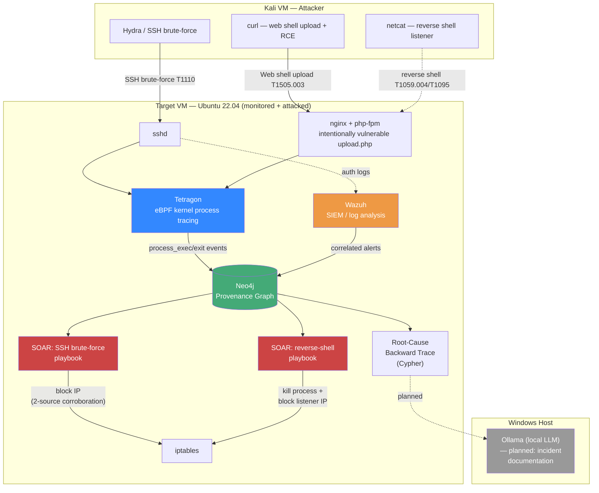

# AutoForensic-X

**A free, self-hosted alternative to paid "agentic SOC" platforms** — combining SIEM detection, kernel-level provenance tracing, causal root-cause reconstruction, and safety-gated auto-remediation (SOAR) in one open architecture.

> Built as a hands-on home lab / portfolio project by [Roshan](https://github.com/) while working toward a SOC Analyst / cloud security role. Every capability below has been built *and validated against real, live attacks* run in an isolated VirtualBox lab — nothing here is theoretical.

---

## The problem this project is answering

Commercial "agentic SOC" platforms (Dropzone AI, Prophet Security, Radiant Security, Microsoft Security Copilot, and similar) combine detection, root-cause analysis, and auto-remediation — but they're all paid enterprise SaaS. No free, self-hosted tool today combines SIEM + SOAR + IDS/IPS + MITRE ATT&CK mapping + real causal provenance tracing in one package. Wazuh is the closest free building block, but on its own it still needs Suricata, TheHive/Cortex/Shuffle bolted on to get there.

**AutoForensic-X's goal:** be the first free, self-hosted alternative to that category — with a genuine causal-graph root-cause reconstruction engine (not just log correlation), and safety-first auto-remediation, not just alerting.

---

## Architecture



**Design principle: the Windows host stays OUT of the monitored/attacked lab entirely.** Tetragon (Linux eBPF) can't run on Windows anyway, and keeping detection/attack-simulation/remediation confined to an isolated host-only VM network means a misfired playbook can never act on the analyst's own machine. The one planned exception is Ollama, which needs the host's GPU and will only ever receive read-only data *from* the lab over the host-only network — it never gains the ability to act back into it.

### The 7-layer design (per the full architecture spec)

| # | Layer | Status |
|---|-------|--------|
| 1 | **Collection** — Tetragon (eBPF) + Wazuh (SIEM); Suricata (network IDS/IPS) is V2 scope | ✅ Done |
| 2 | **Correlation & Provenance Graph** — Neo4j, joins kernel process events to SIEM alerts | ✅ Done |
| 3 | **Root-Cause Backward Trace** — walks the graph from an alert back to the true entry point | ✅ Done |
| 4 | **SOAR / Remediation** — tiered-autonomy playbooks, human-approval-gated for destructive actions | 🟡 In progress (2 of N playbooks) |
| 5 | **Deterministic MITRE ATT&CK Mapping** — via Wazuh's rule engine | ✅ Done (built-in) |
| 6 | **Local LLM Documentation** — Ollama-generated incident narrative + hardening recommendations | ⬜ Not started |
| 7 | **Dual Interface** — live monitoring pipeline separate from the SIEM case dashboard | ⬜ Not started (V2 scope) |

---

## Where things stand right now

### ✅ Fully built and validated against real attacks

**Lab foundation** — Two VirtualBox VMs on an isolated host-only network: `AutoForensic-Target` (Ubuntu 22.04.5 LTS) and `AutoForensic-Kali` (Kali 2026.2), fully isolated from the analyst's own Windows host.

**Collectors** — [Tetragon](https://github.com/cilium/tetragon) (eBPF-based kernel process tracing, CNCF project) and [Wazuh](https://wazuh.com/) (SIEM/log analysis) both running as systemd services on the Target VM, validated with live process/alert capture.

**Provenance Graph Engine** (`/provenance-graph`) — A Neo4j graph database that ingests both Tetragon process events and Wazuh alerts in real time (`ingest_tetragon.py`, `ingest_wazuh.py`), correlating them via a timestamp-window join (`graph_writer.py`). Schema (`schema.cypher`) models `Process`, `Alert`, and `Host` nodes with `PARENT_OF` / `RAN_ON` / `SEEN_ON` / `CORRELATES_WITH` relationships.

**Root-Cause Backward Trace** (`trace_root_cause.cypher`) — Given any alert or process, walks backward through the kernel-confirmed process-ancestry chain to the true entry point. Validated example: an alert tagged `T1078` traced cleanly back through `sshd → bash` to identify `sshd` as the root cause — turning "a login happened" into "here's the exact chain that caused it."

**SOAR / Auto-Remediation** (`/soar`) — Two playbooks so far, both following the same safety template (2-source corroboration required before acting, hard-coded allowlist, input validation before any subprocess call, human-approval-gated confirmation for every destructive action, full JSON audit trail, and a `Remediation` node written back into the graph for traceability):

- `soar_ssh_bruteforce.py` — detects a source IP with a cluster of Wazuh auth-failure alerts *and* a Tetragon-confirmed `sshd` process behind them, proposes an `iptables` block, and — after operator approval — blocks it. Verified end-to-end: block took effect (SSH connections hung/dropped), then `--unblock` cleanly restored access.
- `soar_reverse_shell.py` — detects a live `/dev/tcp/...` reverse-shell command that is a Tetragon-confirmed descendant of a network-facing service (`php-fpm`/`nginx`/`sshd`), then — after approval — kills the process (re-verifying against the live system's `/proc` first, to guard against PID reuse) and blocks the attacker's listener IP. **Verified against a genuinely live attacker session**: killed an actual open reverse shell and confirmed it was dead by testing for a response on the attacker side.

### Validated against 3 real, live attack techniques

| Technique | MITRE ID | Tetragon caught it | Wazuh alerted | SOAR playbook |
|---|---|---|---|---|
| SSH brute-force | T1110 | ✅ | ✅ | ✅ blocks source IP |
| Web shell upload + RCE | T1505.003 | ✅ | ❌ (detection gap — see below) | ⬜ not yet |
| Reverse shell | T1059.004 / T1095 | ✅ | ❌ (same gap) | ✅ kills process + blocks listener |

**A genuinely useful finding, not a bug:** Wazuh's default ruleset generated *zero* alerts for the web shell or reverse shell — it has no log source for "a PHP-FPM worker spawned a shell that opened an outbound socket" without added `auditd`-based command auditing. This is exactly why the multi-collector design matters: Tetragon's kernel-level eBPF tracing caught the *entire* attack chain with no blind spots, while a log-based SIEM alone would have missed it completely. This is the core argument for why AutoForensic-X exists rather than "just run Wazuh."

### 🐛 Along the way

Two real bugs were found and fixed during the build (both documented in code comments): a timestamp-parsing bug that silently broke 100% of alert-to-process correlation (Python's strict `datetime.fromisoformat()` couldn't handle Wazuh's `+0000`-style offsets or Tetragon's nanosecond-precision timestamps — fixed by switching to `dateutil.parser.isoparse()`), and an LVM disk-allocation issue that caused a mid-session disk-exhaustion crisis (fixed live, with zero data loss, and — notably — the crisis itself was *caught and correctly correlated* by the running pipeline, which is a nice unplanned proof that the collectors work).

---

## What's next

1. **A third SOAR playbook** for the web-shell upload/RCE stage itself — trickier than the other two, since the right remediation (delete the uploaded file? restart php-fpm? disable the endpoint?) needs more design thought before implementing.
2. **Local LLM documentation (Ollama)** — feed the root-cause trace + remediation history into a locally-run model to auto-generate a plain-English incident report ("what happened, how it was caught, how it was stopped, how to prevent recurrence"). Runs on the Windows host's GPU, read-only access to the lab.
3. **Live dashboard** — a single operational view separate from Wazuh's own dashboard, showing the provenance graph and remediation history together.
4. **Metrics / benchmarking** — mean-time-to-detect, mean-time-to-remediate, false-positive rate, measured against the scripted attack runbooks.
5. **Network layer (Suricata)** — V2 scope; adds inline network IDS/IPS, deepens the provenance graph with network-level nodes.
6. **Packaging & open-source release** — once the core loop (detect → correlate → trace → remediate) is fully proven, package for others to stand up their own instance.

---

## Repo structure

```
AutoForensic-X/
├── README.md                      ← you are here
├── provenance-graph/
│   ├── SETUP.md                   ← install/run instructions (Neo4j, venv, ingesters)
│   ├── schema.cypher              ← graph schema (constraints + indexes)
│   ├── config.py                  ← env-var-driven connection config
│   ├── graph_writer.py            ← Neo4j driver wrapper (upsert + correlation logic)
│   ├── ingest_tetragon.py         ← streams live Tetragon events into the graph
│   ├── ingest_wazuh.py            ← tails Wazuh's alerts.json into the graph
│   ├── trace_root_cause.cypher    ← root-cause backward-trace query
│   └── requirements.txt
└── soar/
    ├── soar_ssh_bruteforce.py     ← SSH brute-force detection + IP block
    └── soar_reverse_shell.py      ← reverse-shell detection + process kill + IP block
```

All of this runs on a single Ubuntu VM (Tetragon, Wazuh, Neo4j, and the Python pipeline together), matching the project's "V1 single-host MVP" scope — nothing here touches the analyst's own machine.

---

## Stack

Tetragon (eBPF/CNCF) · Wazuh (SIEM) · Neo4j (graph database) · Python 3 · Cypher · VirtualBox (host-only isolated lab network) · Ubuntu 22.04 LTS · Kali Linux (attack simulation)
